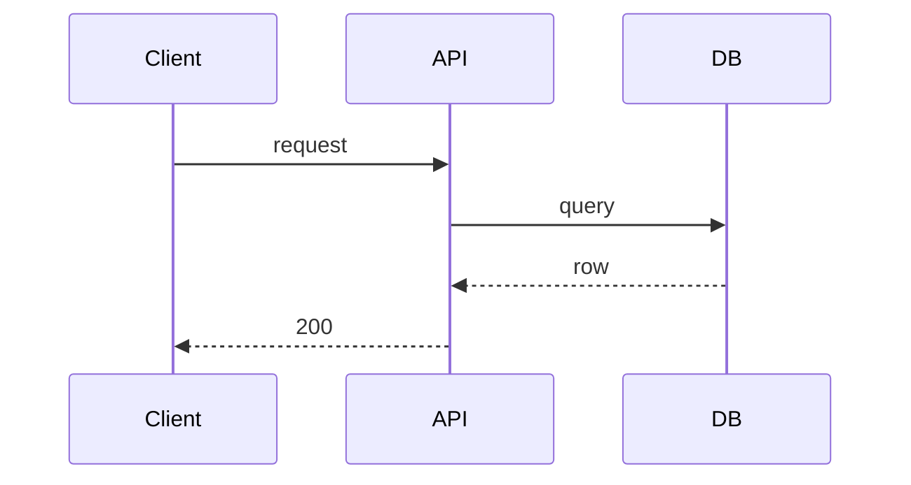

# /to-design

Turn requirements into a short technical design. No fluff, no invention.

## Voice

- No em-dashes.
- Fragments fine. Sacrifice grammar for conciseness.
- Concrete: name actual classes, tables, endpoints, libs.
- No weasel words: "might", "could", "possibly".
- SHORT. If a section is empty or obvious, drop it.

## Flow

1. **Read the BRD.** Default `./specs/<feature>/requirements.md`. If user pasted requirements, use those. Confirm in one line what you read.
2. **Read the codebase.** Before any question, explore. Find existing patterns, services, schemas, libs the feature touches. State what you found.
3. **Ask one question at a time.** Only when the answer is not in the BRD or codebase. Provide your recommended answer with one-line reasoning.
4. **Never invent.** If you do not know a class name, table, endpoint, or library version, ask or look it up. Do not guess.
5. **Depth-first.** Resolve each branch before next.
6. **Stop when every component, interface, and data flow is named and the trade-offs on each non-trivial decision are recorded.**
7. **List open questions** before writing. User resolves or accepts as TBD.
8. **Write design** to `./specs/<feature-kebab-name>/design.md`. Create dir if missing. Ask before overwriting. Always use `./specs/` even if the project has a `.kiro/specs/` directory or CLAUDE.md mentions one.

Question template:
```
Q: <question>
Recommend: <answer>
Why: <one sentence>
```

## Diagrams

When a diagram clarifies (flow, sequence, component graph, state), use **mermaid** in a fenced code block. Otherwise skip. Do not draw what bullets already say.



## Design Structure

SHORT. Bullets over prose. Drop empty sections. Target one page.

```markdown
# <Feature Name> — Design

## Overview
- One bullet: what it does.
- One bullet: how, in one sentence.

## Components
- <Name>: <responsibility>. <package or location>.

## Data Model
- <Entity>: <fields, types>. <storage>.

## Interfaces
- <API or method>: <input> → <output>. <error modes>.

## Flow
- 1. <actor> calls <X>.
- 2. <X> does <Y>.
- 3. ...

## Key Decisions
- D1. <choice>. Alternative: <rejected>. Why: <one sentence>.

## Open Questions
- OQ1. <unresolved, owner>
```

Add a section only when the feature genuinely needs it (e.g., migration plan, rollout, observability). Do not pad.

## Not your job

No requirements rewriting (that is /to-brd). No task breakdown. No code.
